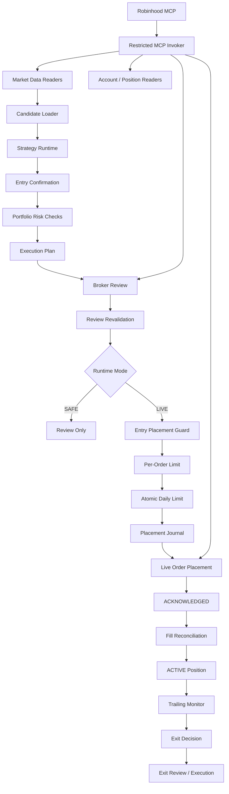

# Stock-Agent

A safety-first agent runtime for broker-integrated equity execution.

Stock-Agent separates strategy, review, execution, reconciliation, and recovery into explicit lifecycle stages, with fail-closed controls around live broker writes. It integrates with Robinhood through MCP and supports both review-only execution and explicitly authorized live equity orders.

The project is designed around a simple principle:

> An agent should never gain trading authority just because it generated a trade idea.

Instead, every live action must pass through deterministic safety checks, broker review, persistent execution state, and post-submit reconciliation.

---

## Overview

Stock-Agent is an experimental execution runtime for equities and broad-market ETFs.

The system currently supports:

- Strategy-driven entry evaluation
- Review-only and explicitly enabled LIVE execution modes
- Robinhood MCP integration
- Persistent order and position state
- Broker-side order review before placement
- Quote freshness validation
- Regular-market-hours execution gates
- Entry placement recovery
- Fill confirmation and position activation
- Stateful trailing-stop evaluation
- Atomic daily exposure limits
- Fail-closed recovery behavior

The project intentionally does **not** support:

- Options trading
- Cryptocurrency
- Margin
- Leveraged ETFs
- Inverse ETFs
- Unbounded autonomous execution

---

## Design Goals

The project is built around four engineering goals.

### 1. Separate reasoning from execution

A strategy may recommend a trade, but it cannot directly place one.

```text
Market Data
    ↓
Strategy
    ↓
Confirmation
    ↓
Risk Checks
    ↓
Execution Plan
    ↓
Broker Review
    ↓
Safety Revalidation
    ↓
Placement
```

Each stage has a narrow responsibility and can independently reject the action.

### 2. Fail closed

Missing, stale, inconsistent, or ambiguous information prevents execution.

Examples include:

- stale quotes
- future-dated quotes
- unavailable account state
- unresolved previous submissions
- mismatched broker reviews
- unexpected option exposure
- concurrent state updates
- unknown order outcomes

The runtime prefers skipping a trade over guessing.

### 3. Persist execution state

Broker writes are tracked in durable journals rather than relying on in-memory control flow.

This allows the runtime to reason about states such as:

```text
PREPARED
    ↓
SUBMITTING
    ↓
ACKNOWLEDGED
    ↓
ACTIVATED
```

and recover safely after uncertain broker responses or process restarts.

### 4. Minimize live capabilities

SAFE and LIVE execution are separate runtime modes.

SAFE mode cannot inherit LIVE behavior from ambient configuration, and MCP access is restricted to explicit tool allowlists.

---

## Architecture



---

## Runtime Modes

### SAFE

SAFE mode performs the full strategy and review path without allowing live entry placement.

```text
strategy
→ confirmation
→ risk
→ execution plan
→ broker review
→ revalidation
→ REVIEW_APPROVED
```

No live entry order is submitted.

SAFE mode is also protected against accidentally inheriting LIVE settings from the surrounding environment.

---

### LIVE

LIVE mode must be explicitly requested and confirmed.

A LIVE runtime is only considered enabled when all required execution and recovery components are available.

```text
LIVE requested
        ↓
runtime safety checks
        ↓
recovery state clear
        ↓
preflight clear
        ↓
LIVE enabled
```

LIVE execution is not enabled simply because a strategy produces an approved candidate.

---

## Entry Execution Lifecycle

The current equity entry lifecycle is:

```text
Candidate
    ↓
Confirmation
    ↓
Portfolio Risk
    ↓
Execution Plan
    ↓
Broker Review
    ↓
Freshness Revalidation
    ↓
Per-Order Guard
    ↓
Daily Limit Reservation
    ↓
PREPARED
    ↓
SUBMITTING
    ↓
Broker Placement
    ↓
ACKNOWLEDGED
    ↓
Fill Verification
    ↓
ACTIVATED
```

A real small-notional LIVE equity entry canary has successfully passed through the broker write path and was subsequently reconciled from `ACKNOWLEDGED` to `ACTIVATED`.

---

## Safety Controls

### Per-order notional limit

LIVE equity entries are limited to:

```text
$5 maximum per order
```

The guard runs before the broker placement call.

---

### Daily entry limit

The runtime enforces:

```text
$10 maximum reserved LIVE entry notional per trading day
```

The reservation is persistent and atomic.

Reserved states include:

```text
PREPARED
SUBMITTING
UNCERTAIN
ACKNOWLEDGED
ACTIVATED
```

`PREPARED` already consumes daily capacity so concurrent processes cannot independently pass the limit and overspend.

---

### Quote freshness

Market-data timestamps are validated against a shared freshness contract.

Default maximum quote age:

```text
30 seconds
```

The runtime rejects:

```text
quote timestamp > current time
→ future quote

quote age > 30 seconds
→ stale quote
```

The exact 30-second boundary is allowed.

---

### Entry quote revalidation

Entry execution uses a fresh execution clock rather than the stable cycle timestamp.

This prevents a quote fetched during a cycle from being incorrectly validated against an older orchestration timestamp.

---

### Exit quote revalidation

LIVE exit execution validates quote freshness twice:

```text
get exit quote
      ↓
freshness check
      ↓
broker review
      ↓
freshness recheck
      ↓
submit
```

If a quote becomes stale while the broker review is taking place, submission is blocked.

---

### Regular market session gate

New trailing observations and new exit submissions are limited to the regular XNYS market session.

Reconciliation is intentionally different:

```text
CLOSING reconciliation
→ allowed outside regular market hours

new trailing observations
→ regular session only

new exit intent
→ regular session only

new LIVE sell submission
→ regular session only
```

This allows the runtime to recover existing execution state without creating new trading activity outside the intended session.

---

## Persistent Placement Recovery

Entry placement uses a durable journal to handle ambiguous broker outcomes.

The critical write path is:

```text
reserve PREPARED
      ↓
mark SUBMITTING
      ↓
broker API call
      ↓
ACKNOWLEDGED
```

If the application loses certainty during submission, the runtime does not automatically retry the order.

Instead, unresolved attempts block further LIVE execution until reconciliation determines what happened.

This prevents duplicate placement after network failures or uncertain broker responses.

---

## Position Activation

Broker acknowledgement alone does not create an active local position.

The runtime independently reads the broker order and verifies:

- broker order ID
- placement reference ID
- symbol
- BUY side
- filled state
- cumulative quantity
- average fill price
- transaction timestamp

Only after fill confirmation does the runtime create an `ACTIVE` position.

```text
ACKNOWLEDGED
      ↓
broker order lookup
      ↓
FILLED
      ↓
position activation
      ↓
ACTIVE
```

Activation is idempotent and validates provenance before accepting an existing position.

---

## Trailing-Stop State Machine

Each active equity position stores persistent monitoring state including:

```text
entry price
remaining quantity
highest executable bid
trailing armed state
trailing armed timestamp
activation gain ratio
drawdown ratio
last quote timestamp
state version
```

Current defaults:

```text
Activation gain: +4%
Trailing drawdown: 2%
```

For example, if an entry price were `$100`:

```text
arm threshold = $104
```

After the trailing stop is armed, if the highest observed executable bid reaches `$110`:

```text
exit threshold
= $110 × (1 - 0.02)
= $107.80
```

A bid at or below `$107.80` would generate an exit decision.

The state machine maintains a monotonic high-water mark:

```text
highest_bid =
max(previous_highest_bid, latest_bid)
```

Quotes must also advance monotonically in time.

---

## Exit Execution

Exit processing is intentionally separated from entry processing.

Each runtime cycle performs exit handling first.

```text
reconcile existing exits
        ↓
monitor ACTIVE positions
        ↓
evaluate trailing state
        ↓
exit actionable?
   ┌────┴────┐
   │         │
  yes        no
   │         │
execute     entry cycle
exit
```

If an exit is actionable, entry execution for that cycle is suppressed.

The runtime also refuses to process multiple simultaneous actionable exits in the same cycle until that behavior is explicitly designed and tested.

---

## Broker Review

A live exit is not submitted immediately after building an order.

```text
Exit Intent
    ↓
Fresh Exit Quote
    ↓
Submission
    ↓
Robinhood Review
    ↓
Exact Submission Match
    ↓
Approval Check
    ↓
Freshness Revalidation
    ↓
Broker Submit
```

The runtime rejects:

- rejected broker reviews
- review errors
- reviews whose submission differs from the requested submission
- stale quotes before review
- quotes that become stale after review

---

## Least-Privilege MCP Access

SAFE runtime components operate through restricted MCP invokers.

Typical read/review capabilities include:

```text
get_equity_fundamentals
get_portfolio
get_equity_positions
get_option_positions
get_equity_orders
get_option_orders
get_equity_quotes
get_equity_historicals
review_equity_order
```

SAFE execution excludes live placement tools.

LIVE entry execution receives only the minimum additional capability needed for its placement path.

This prevents unrelated components from gaining broker-write access simply because they share the same MCP connection.

---

## Repository Structure

```text
src/stock_agent/
├── brokers/
│   └── robinhood/
│       ├── broker_runtime.py
│       ├── entry_execution_limits.py
│       ├── entry_placement.py
│       ├── entry_fill.py
│       ├── entry_activation.py
│       ├── entry_preflight_reader.py
│       ├── equity_exit_price_provider.py
│       ├── exit_executor.py
│       ├── placement_journal.py
│       ├── restricted_mcp_invoker.py
│       └── ...
│
├── cli/
│   ├── robinhood_equity_once.py
│   └── robinhood_live_readiness.py
│
├── domain/
│
├── execution/
│
├── market_data/
│   └── freshness.py
│
├── monitoring/
│   └── trailing_stop_monitor.py
│
├── orchestration/
│   ├── entry_placement_cycle.py
│   ├── entry_review_cycle.py
│   ├── robinhood_equity_exit_cycle.py
│   ├── robinhood_live_readiness.py
│   ├── robinhood_runtime_cycle.py
│   ├── robinhood_runtime_runner.py
│   └── robinhood_strategy_cycle.py
│
├── risk/
│   ├── entry_portfolio.py
│   └── trailing_stop.py
│
├── state/
│   └── sqlite_store.py
│
└── strategy/
```

Tests are separated into:

```text
tests/
├── unit/
└── integration/
```

---

## Running Locally

Create a virtual environment:

```bash
python -m venv .venv
```

Activate it:

```bash
source .venv/bin/activate
```

Install dependencies:

```bash
pip install -r requirements.txt
```

---

## SAFE One-Shot Runtime

SAFE mode is the default production-oriented execution path.

```bash
python -m stock_agent.cli.robinhood_equity_once \
  --account-number YOUR_ACCOUNT_NUMBER \
  --symbols AAPL \
  --mode safe \
  --budget 5
```

Example SAFE outcome:

```text
runtime_mode=safe
live_execution=DISABLED

entry cycle status: ran
universe selected: AAPL
loaded candidates: 1

entry candidate: AAPL
  status: review_approved
  eligible to place: True
  confirmation approved: True
  risk approved: True
  execution plan built: True
  broker review performed: True
  broker review approved: True

entry placements: 0
```

A review-approved candidate in SAFE mode still produces no live broker write.

---

## LIVE Readiness Check

Before enabling LIVE execution:

```bash
python -m stock_agent.cli.robinhood_live_readiness \
  --account-number YOUR_ACCOUNT_NUMBER \
  --order-notional 5
```

The readiness probe checks:

```text
exit recovery
entry recovery
activation reconciliation
entry preflight
daily notional capacity
```

A runtime should only proceed toward LIVE execution when the result is:

```text
status: READY
```

---

## LIVE Execution

LIVE execution requires both LIVE mode and explicit confirmation:

```bash
python -m stock_agent.cli.robinhood_equity_once \
  --account-number YOUR_ACCOUNT_NUMBER \
  --symbols AAPL \
  --mode live \
  --confirm-live \
  --budget 5
```

This command can place a real broker order.

Do not use LIVE mode without understanding the execution limits, recovery behavior, and current project limitations.

---

## Testing

The project uses deterministic unit and integration tests around execution-critical boundaries.

Coverage includes:

- SAFE vs LIVE isolation
- ambient LIVE configuration override
- runtime capability restrictions
- broker review validation
- quote freshness
- future quote rejection
- exact freshness boundary behavior
- post-review freshness revalidation
- position-state concurrency
- trailing-stop state transitions
- regular-session monitoring gates
- per-order limits
- atomic daily limits
- placement recovery
- fill activation
- idempotent reconciliation
- entry/exit orchestration ordering

Run the full suite with:

```bash
python -m unittest discover -v
```

Focused execution-safety tests can also be run independently:

```bash
python -m unittest \
  tests.unit.strategy.test_entry_execution \
  tests.unit.monitoring.test_trailing_stop_monitor \
  tests.unit.brokers.robinhood.test_exit_executor \
  tests.unit.orchestration.test_robinhood_runtime_cycle \
  -v
```

---

## Current Status

### Completed

- [x] SAFE / LIVE runtime separation
- [x] Explicit LIVE confirmation
- [x] Restricted MCP tool capabilities
- [x] Equity-only LIVE entry path
- [x] `$5` per-order LIVE entry limit
- [x] `$10` persistent daily entry limit
- [x] Atomic entry reservation
- [x] Broker review before placement
- [x] Entry placement journal
- [x] Uncertain-placement recovery
- [x] LIVE entry canary
- [x] Broker fill verification
- [x] ACKNOWLEDGED → ACTIVATED lifecycle
- [x] Persistent active-position state
- [x] Stateful trailing-stop evaluation
- [x] Regular-session monitoring gate
- [x] 30-second quote freshness contract
- [x] Future quote rejection
- [x] LIVE exit pre-review freshness check
- [x] LIVE exit pre-submit freshness revalidation

---

## Current Limitations

Stock-Agent is still under active development.

The current production CLI executes one runtime cycle at a time.

Because trailing stops are implemented in the local runtime rather than as broker-native standing orders, a one-shot process cannot observe price movement while it is offline.

For example:

```text
agent observes $105
        ↓
process stops
        ↓
market reaches $115
        ↓
market drops to $108
        ↓
agent starts again
```

Without continuous sampling, the local runtime may never observe the `$115` high-water mark.

For this reason, unattended synthetic trailing-stop execution is **not yet considered production-ready**.

Additional exit-side crash/restart and terminal order-state cases are also still being hardened.

---

## Roadmap

### Continuous monitoring

- [ ] Persistent SAFE monitoring loop
- [ ] Multi-cycle trailing-stop integration tests
- [ ] Graceful shutdown
- [ ] Retry and backoff policy
- [ ] Single-instance runtime protection
- [ ] Market close / reopen behavior

### LIVE exit lifecycle

- [ ] Final unattended exit authorization contract
- [ ] Exit-side least-privilege capability isolation
- [ ] LIVE exit canary
- [ ] SUBMITTED → CLOSING verification
- [ ] Broker fill → CLOSED reconciliation

### Recovery

- [ ] Crash after broker submission but before local CLOSING update
- [ ] Restart while order is CLOSING
- [ ] Broker-filled / locally-open reconciliation
- [ ] Duplicate-exit prevention after restart
- [ ] Cancelled order handling
- [ ] Rejected order handling
- [ ] Expired order handling

### Operations

- [ ] Runtime status CLI
- [ ] Position monitoring diagnostics
- [ ] Unresolved execution diagnostics
- [ ] Long-running SAFE endurance tests
- [ ] Unattended LIVE runtime

---

## Safety Philosophy

Stock-Agent is intentionally conservative.

The runtime follows several invariants:

```text
No fresh data
→ no trade

Unknown broker outcome
→ no retry

Unresolved execution
→ block additional LIVE execution

Mismatched review
→ no trade

Outside regular market session
→ no new trailing observation or exit submission

SAFE runtime
→ no live placement capability

LIVE runtime
→ explicit authorization + deterministic limits
```

The objective is not to maximize the number of trades.

The objective is to make every broker write explainable, bounded, recoverable, and auditable.

---

## Disclaimer

This project is an experimental software engineering project and is not financial advice.

LIVE mode can submit real orders to a brokerage account. Use it only with accounts, permissions, limits, and capital you explicitly intend to expose to automated execution.